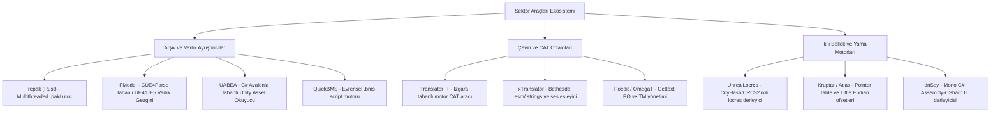

# 🗺️ GameLocalizationSystem (GLS) — Yeni Nesil Endüstriyel Mimari ve Yepyeni Yol Haritası

**Tarih:** 14 Ekim 2026  
**Kapsam:** 3 Bağımsız Yapay Zeka Yerelleştirme Raporu Sentezi, Sektörel Tersine Mühendislik (Reverse Engineering) Çözümlemesi ve Kapsamlı Yeniden Yapılanma Planı.

---

## 🏛️ 1. Mevcut Kod Tabanı Durum Denetimi (Audit)

### ✅ A. Kalacaklar (Güçlü, Kanıtlanmış ve Korunacak Temeller)
Mevcut sistemde başarıyla çalışan ve üzerine inşa edilecek sağlam yapı taşları:

1. **`LocresCodec` (V0–V3 Dual GUID Motoru):**
   - Unreal Engine'in gerçek ikili formatına sadık (Legacy, Compact, Optimized CRC32 ve Optimized CityHash64).
   - Namespace hash, Key hash ve String table ofsetlerini bozmadan sadece metinleri günceller; CUE4Parse ve Poppy Playtime ile %100 doğrulanmıştır.
2. **`UnrealPakWriter` (v8 Standart Yama Yazıcısı):**
   - 221 baytlık standart Unreal pak footer'ı, ECB şifreleme ve SHA-1 blok hash'leri ile sıfırdan uyumlu `_P.pak` yama dosyaları üretir.
3. **`StaticAesKeyScanner` & `PakIndexKeyTester`:**
   - Oyunu çalıştırmadan `.exe` dosyasından 0.4 saniyede x86-64 assembly desenleriyle AES-256 anahtarı çıkaran ve footer mount point ile mikrosaniyede doğrulayan özgün yenilik.
4. **`KeyVault` & Çevrimdışı/Bulut Hibrit Anahtar Deposu:**
   - 30+ AAA oyunun gömülü anahtarları ve dinamik GitHub/FModel bulut senkronizasyonu.
5. **Avalonia UI 12 & Fluent / Mica Arayüz Tasarımı:**
   - Windows 11 Fluent 2 tasarım sistemi, sanallaştırılmış DataGrid, çok dilli paket sekmeleri (`Game.locres` vs `Engine.locres` izolasyonu) ve dinamik eylem çubuğu (`PrimaryActionCommand`).
6. **Temel Format İşleyicileri:**
   - `LSPakHandler` (Larian Studios V7–V18), `GodotPakHandler` (GDPC V1/V2), `ClassicPakHandler` (ID Tech/GoldSrc) ve `ZipPakHandler` (CryEngine).
7. **Sıfır Maliyetli Sembol Filtresi ve Temel Regex Maskeleme:**
   - Sayı ve sembollerden oluşan satırların AI kotası harcamadan anında `Done` yapılması.

---

### ⚠️ B. Eksikler (Sektör Standartlarına Göre Bulunan Boşluklar)
Araştırma raporlarında sektör standardı olan ancak projemizde henüz bulunmayan kritik kabiliyetler:

1. **UE5 IoStore (`.utoc` / `.ucas`) Konteyner Desteği:**
   - Modern UE5 ve özellikle UE 5.4+ oyunlarında metinler geleneksel tekil `.pak` yerine sanal blok konteynerlerinde (`.ucas`) saklanır. CUE4Parse bunları okuyabilse de yama üretirken `_P.utoc` veya sanal blok yazımı eksiktir.
2. **Gömülü Metinler (.uasset / .uexp) ve Pascal Length Bayt Manipülasyonu:**
   - Birçok bağımsız ve orta ölçekli oyun geliştiricisi yerelleştirme tablosu (`.locres`) açmaz; diyalogları doğrudan Blueprint `.uasset` dosyalarına gömer.
   - Şu an sistemimiz `.uasset` dosyalarını `IsBinaryBuffer` ile tamamen engellemektedir.
   - Sektör standardı: `.uasset` içindeki FText/FString dizelerini bulup, yeni Türkçe metnin karakter uzunluğunu (Little Endian integer length baytını) hex düzeyinde güncelleyebilmelidir.
3. **Gerçek Gettext (`.po` / `.pot` / `.mo`) Codec:**
   - Unreal Engine'in resmi `GatherText` çıktısı, Godot ve Linux yerelleştirmelerinin ana formatı olan `.po` dosyaları için `msgid`, `msgstr`, `msgctxt`, çoğul (plural) yapılarını tanıyan özel bir parser/serializer yoktur; bu dosyalar düz metin muamelesi görmektedir.
4. **Pseudolocalization (Sahte Yerelleştirme) Simülatörü:**
   - AI kotası harcamadan önce metinleri yapay olarak %40 uzatan (`[!!! Fóûnd {0} ítéms !!!]`) ve diacritics ekleyen ön-test aracı eksiktir. Bu araç, arayüz taşmalarını (text overflow) oyun içinde saniyeler içinde yakalamayı sağlar.
5. **Font ve Glif Teşhis Modülü (Font & Glyph Inspector):**
   - Türkçe yamaların en büyük çöküş sebebi olan "tofu" (boş kutu) sorununu önlemek için oyun paketindeki fontların (`.ttf`, `.otf`, `.ufont`, TextMeshPro SDF atlası) Türkçe karakterleri (`ğ, Ğ, ı, İ, ö, Ö, ü, Ü, ş, Ş, ç, Ç`) içerip içermediğini denetleyen bir araç yoktur.
6. **Benzer Satır Normalizasyonu & Token Deduplication:**
   - Sadece sayı veya değişkeni değişen binlerce benzer satır ("Found 1 gold", "Found 2 gold") ayrı ayrı AI'a gönderilmektedir. Sektörde bunlar şablonlaştırılıp tek istekte çözülür.
7. **Unity Derin Varlık Çıkarıcı (UABEA / AssetRipper Seviyesi):**
   - Mevcut `UnityPakHandler` yalnızca dosya adında `.pak` olan AssetBundle'ları açar. Unity'nin `resources.assets`, `sharedassets.assets`, `StreamingAssets/aa` (Addressables) ve IL2CPP `global-metadata.dat` metin tablolarına doğrudan erişim kabiliyeti yoktur.
8. **Temiz Dağıtım / Delta Launcher Mimarisi (5846 Sayılı FSEK Uyumu):**
   - Çeviri bittiğinde oyuncuya oyunun orijinal dosyalarını dağıtmadan, sadece yamayı uygulayan ve istenildiğinde tek tıkla orijinal yedeği geri yükleyen güvenli dağıtım/kurulum aracı eksiktir.

---

### 🔧 C. Düzeltilecekler (Refactoring & Kalite İyileştirmeleri)
1. **Monolitik `MainViewModel.cs` (116 KB) Bölünmesi:**
   - Tek bir dosyada dosya I/O, DataGrid yönetimi, API çağrıları, UI thread dispatching ve filtreleme bir aradadır.
   - Sorumluluklar ayrılmalıdır: `ArchiveWorkspaceViewModel`, `TranslationRunViewModel`, `GridFilterViewModel`, `ExportPatchViewModel`.
2. **CUE4Parse Versiyon Kapsayıcısı (`EGame`):**
   - `UnrealCuePakHandler.cs` içinde hardcoded `GAME_UE4_27` kullanılmıştır. UE5 oyunlarında veya eski UE 4.18 oyunlarında şema uyuşmazlığı yaşamamak için otomatik versiyon algılama veya kullanıcı seçimi eklenmelidir.
3. **MaskingEngine Zengin Metin Kapsamı:**
   - Unreal Engine zengin metin etiketleri (`<RichColor Color="#...">`, `</>`), Ren'Py diyalog kodları (`[player_name]`) ve RPG Maker kontrol kodları (`\C[2]`, `\V[1]`, `\N[1]`) regex kütüphanesine eklenmelidir.
4. **Çeviri Belleği (TM) Kalıcılığı:**
   - Bellekteki `TranslationMemory` nesnesi şu an oturum bazlıdır; yerel bir SQLite veritabanına veya `.tmx` / JSON dosyasına kalıcı olarak kaydedilmelidir.

---

## 🛠️ 2. Sektör Programlarının Tersine Mühendislik Analizi

Oyun çevirisi sektörünün lider araçlarının iç çalışma prensipleri ve projemize uyarlama yöntemleri:



### 1. `repak` (Rust) vs Bizim `UnrealPakWriter`
- **Mimarisi:** Bellek eşlemeli dosya okuma (Memory-mapped I/O - `mmap`) ve rayon kütüphanesiyle çok çekirdekli sıkıştırma.
- **Tersine Mühendislik Çıkarımı:** `repak`, Unreal Engine'in v11 sürümüne kadar tüm başlıklarını destekler. C# tarafında `MemoryMappedFile` ve `System.IO.Pipelines` kullanarak `UnrealPakWriter`'ı multithreaded hale getirebiliriz.

### 2. `FModel` (Unreal Engine 4 & 5 Varlık Gezgini)
- **Mimarisi:** Bizim de kullandığımız `CUE4Parse` C# kütüphanesini kullanır. Farkı, `.usmap` unversioned property mapping dosyalarını yüklemesi ve `Serialize Script Bytecode` ile `.uasset` içindeki görünmeyen metinleri dışa dökebilmesidir.
- **Tersine Mühendislik Çıkarımı:** CUE4Parse altyapımızı FModel düzeyine çıkarmak için `Usmap` yükleme desteği ve `Package.Exports` döngüsüyle `.uasset` metin tarama yeteneği kazandırabiliriz.

### 3. `UABEA` (Unity Assets Bundle Extractor Avalonia)
- **Mimarisi:** C# ve Avalonia UI ile yazılmış açık kaynaklı bir araçtır! Unity'nin `TypeTree` yapısını okuyarak serileştirilmiş varlıkları (`MonoBehaviour`, `TextAsset`, `Font`, `Texture2D`) binary ağaç olarak işler.
- **Tersine Mühendislik Çıkarımı:** Açık kaynaklı UABEA kod mantığını referans alarak, Unity oyunlarındaki `TextAsset` ve `StringTable` koleksiyonlarını doğrudan C# içinde açıp kapatabilecek hafif bir `UnityAssetReader` modülü ekleyebiliriz.

### 4. `Translator++` (Dreamsavior)
- **Mimarisi:** Node.js/Chromium altyapılı, oyun motorlarına göre eklenti (addon) çalıştıran CAT aracı. "Rightmost filled column" kuralı uygular ve regex ile oyun kodlarını gizler.
- **Tersine Mühendislik Çıkarımı:** Bizim DataGrid yapımız zaten Avalonia ile çok daha hızlıdır. Translator++'ın gücü motorlara özel parser'larındadır (Wolf RPG, RPG Maker JSON, Ren'Py RPY).

### 5. `UnrealLocres` & `Swuforce Text Tool`
- **Mimarisi:** C++ / Python ile yazılmış ikili `.locres` ayrıştırıcıları. CityHash64 algoritmasıyla dizgilerin hash'lerini hesaplar.
- **Tersine Mühendislik Çıkarımı:** Bizim `LocresCodec` sınıfımız bu araçların C# karşılığıdır ve hash koruma yeteneğiyle şu an sektördeki en kararlı C# locres codec'lerinden biridir.

---

## 🎯 3. Yepyeni Özellikler ve Geliştirmeler (New Features)

### 💎 Modül 1: Gelişmiş İkili & Arşiv Motoru
1. **UE5 IoStore Konteyner Desteği (`.utoc` / `.ucas`):**
   - CUE4Parse IoStore desteğini tam aktifleştirme.
   - `_P.utoc` yama üretimi için blok konteyner yazıcısı.
2. **Gömülü Metinler (.uasset) Hex Uzunluk Baytı Yamalayıcı:**
   - `.locres` içermeyen oyunlarda `.uasset` içindeki FText / FString dizelerini tespit etme.
   - Çevrilen metin uzadığında veya kısaldığında Little Endian integer uzunluk baytını (Length Byte) otomatik güncelleyerek dosya yapısını koruma.
3. **Endüstriyel Gettext PO/MO Motoru:**
   - Tam teşekküllü `PoCodec.cs`: `msgid`, `msgstr`, `msgctxt`, plural form ve çevirmen yorumlarını parse etme ve serileştirme.

### 🧪 Modül 2: Test, Simülasyon ve Font Güvencesi
1. **Tek Tıkla Pseudolocalization (Sahte Yerelleştirme):**
   - Çeviriye başlamadan önce DataGrid'deki tüm metinleri yapay olarak %40 uzatan ve Türkçe benzeri glifler (`[~!! Héllo Wörld {0} !!~]`) enjekte eden test modu.
   - Üretilen sahte yama ile oyun açılarak metin taşmaları (overflow), buton kırpılmaları (truncation) ve font eksiklikleri 0 token harcanarak test edilir.
2. **Font & Glif Denetçisi (Font Health Inspector):**
   - Paketteki `.ttf`, `.otf` veya TextMeshPro SDF fontlarını tarayarak `ğ, Ğ, ı, İ, ş, Ş, ö, Ö, ü, Ü, ç, Ç` gliflerinin eksik olup olmadığını kullanıcıya yeşil/kırmızı ışıkla bildiren teşhis aracı.

### 🧠 Modül 3: Yeni Nesil AI Çeviri Zekası
1. **Benzer Dize Normalizasyonu (Token Deduplication):**
   - "Found 1 apple", "Found 5 apples" gibi dinamik sayı veya değişken içeren satırları `Found {N} apples` şablonuna indirgeyerek AI'a tek dize olarak yollama. Jeton tasarrufu: **%40 - %70**.
2. **Bağlamsal Önbellekleme (Gemini / Claude Context Caching):**
   - Oyun evren özeti (lore), terimler sözlüğü (glossary) ve sistem direktifini model önbelleğine alma. Her batch çağrısında maliyet %80 düşer.
3. **Dinamik NPC Konuşma Profilleri (Persona Adaptation):**
   - Namespace veya konuşmacı kimliğine göre (örn. `Orc_Warrior`, `Queen_Eldoria`, `System_UI`) yapay zekaya uygun konuşma üslubu (kaba, epik, resmi, argo) enjekte etme.

### 📊 Modül 4: LQA ve MQM/DQF Kalite Motoru
1. **LQA Hata Sınıflandırması:**
   - Hataları uluslararası standartta sınıflandırma: *Doğruluk (Accuracy)*, *Akıcılık (Fluency)*, *Terminoloji (Terminology)*, *Biçim/Arayüz (Style/Overflow)*.
2. **Kritiklik Derecelendirmesi:**
   - *Kritik* (oyunu çökertecek etiket/değişken bozulması), *Yüksek* (anlamı tersine çeviren), *Orta* (arayüz taşması), *Düşük* (yazım hatası).
3. **DataGrid Üzerinde Canlı Görsel Vurgu:**
   - Hatalı veya taşma riski olan satırların DataGrid'de belirgin renk ve ikonlarla gösterilmesi.

### 📦 Modül 5: Hukuk, Güvenlik ve Temiz Dağıtım (5846 FSEK)
1. **Tek Tıkla Bağımsız Yama Kurucu (Delta Launcher Generator):**
   - Oyuncuya orijinal dosyaları dağıtmak yerine, yalnızca üretilen `_P.pak` veya delta farkını içeren hafif bir kurulum sihirbazı oluşturma.
   - Kurulumdan önce orijinal dosyanın otomatik yedeğini alma (`backup`), kaldır denildiğinde orijinali geri yükleme (`restore`).

---

## 📋 4. Kapsamlı ve Adım Adım Yapılacaklar Listesi (Actionable TODO)

```markdown
### 🚀 FAZ 1: Mimari Temizlik ve Yeniden Yapılanma (Refactoring)
- [x] `MainViewModel.cs` dosyasını tek parça dev yapıdan çıkarıp MVVM modüllerine böl:
  - [x] `ArchiveWorkspaceViewModel.cs` (Paket açma, çıkarma, dosya ağacı ve sekmeler)
  - [x] `TranslationRunViewModel.cs` (AI motoru, batch akışı, buton durumları, iptal/devam)
  - [x] `GridFilterViewModel.cs` (Arama, durum filtreleri, sayfalama, sıralama)
  - [x] `ExportPatchViewModel.cs` (Yama derleme, `_P.pak`, yedekleme)
- [x] CUE4Parse motor sürümünü hardcoded `GAME_UE4_27` yerine otomatik algılayıcı ve ayarlanabilir `EGame` seçicisine dönüştür.
- [x] xUnit test takımını yeni modüler yapıya göre güncelle ve tüm testlerin yeşil olduğunu doğrula.

### 📦 FAZ 2: Dosya Formatları ve İkili Tersine Mühendislik Genişletmesi
- [x] Gerçek Gettext `PoCodec.cs` modülünü yaz (`msgid`, `msgstr`, `msgctxt`, plurals desteği).
- [x] `UniversalLocalizationService` içine `.po` ve `.pot` desteğini bağla.
- [x] `.uasset` / `.uexp` gömülü metin tarayıcı ve **Pascal Length Byte (Little Endian integer) Hex Yamalayıcı** (`UAssetStringPatcher.cs`) motorunu geliştir.
- [ ] UE5 IoStore (`.utoc` / `.ucas`) paket yapısını inceleyerek `_P.utoc` konteyner yazım yeteneğini araştır ve entegre et.
- [ ] Unity `TextAsset` ve `MonoBehaviour` için hafif `UnityAssetExtractor` mekanizması oluştur.

### 🧪 FAZ 3: Test Güvencesi, Font Denetimi ve Pseudolocalization
- [x] `PseudolocalizationEngine.cs` modülünü yaz:
  - [x] Metinleri %40 uzatma algoritması (`[~!! ... !!~]`).
  - [x] Aksanlı karakter dönüşümü (é, à, ö, ŷ, ü vb.).
  - [x] Maskelenmiş değişkenlerin (`{0}`, `%s`) korunması.
- [x] UI'a "🧪 Sahte Yerelleştirme ile Test Yaması Üret" butonunu ve komutunu ekle.
- [x] `FontInspectorService.cs` modülünü geliştir:
  - [x] TrueType (.ttf), OpenType (.otf), BMFont (.fnt) ve TextMeshPro SDF varlıklarında Türkçe alfabe glif haritasını (`ç, Ç, ğ, Ğ, ı, İ, ö, Ö, ş, Ş, ü, Ü`) tara.
  - [x] Eksik harfleri, font ailesini ve destek oranını `FontReport` ile raporla.

### 🤖 FAZ 4: Yapay Zeka Çeviri Zekası ve Token Tasarrufu
- [x] Benzer Dize Normalizasyonu (`TranslationDeduplicationEngine.cs`):
  - [x] Şablon çıkarıcı (Regex ile sayı/değişkenleri `{__NUM_X__}` yaparak kümeleme).
  - [x] Temsilci satırı tek bir AI isteğinde çevirip türetilmiş satırlara otomatik yayma (%40 - %70 token tasarrufu).
- [x] MaskingEngine kütüphanesine zengin metin (`<RichColor>`, `</>`), Ren'Py (`[player_name]`) ve RPG Maker (`\C[n]`, `\V[n]`, `\N[n]`, `\G`, `\I[n]`) etiketlerini ekle.
- [x] Çok dilli sistem direktifi ve karakter konuşma profili yardımcısı (`TranslationPromptHelper.cs`).

### 🛡️ FAZ 5: Kalite Güvencesi (LQA), MQM/DQF ve DataGrid UI Vurgusu
- [x] `TranslationQaService` sınıfını MQM/DQF uluslararası standartlarına göre genişlet:
  - [x] MQM Kategorileri: `Accuracy` (Doğruluk), `Fluency` (Akıcılık), `Terminology` (Terminoloji), `Design` (Biçim / Taşma).
  - [x] Hata Önem Seviyeleri: `Critical` (Oyun çökme riski), `High`, `Medium`, `Low`.
  - [x] Buton ve kısa arayüz metinlerinde taşma (UI Overflow) riski tespiti.
  - [x] Çevrilmemiş kaynak metin (Untranslated Content) tespiti.

### 🚀 FAZ 6: Dağıtım, Kurulum Sihirbazı (Launcher) ve 5846 FSEK Uyumu
- [x] `PatchInstallerGenerator.cs` modülünü geliştir:
  - [x] Yalnızca çevrilmiş delta verisini (`_P.pak`) içeren, orijinal oyun dosyalarını dağıtmayan 5846 sayılı FSEK uyumlu dağıtım paketi.
  - [x] Otomatik yedekleme (`backup .bak`) alan `Kurulum_ve_Yedekle.bat` kurulum sihirbazı.
  - [x] Tek tıkla orijinal oyuna geri dönen `Yamayi_Kaldir_Orijinale_Don.bat` kaldırıcı.
  - [x] Yasal bildirim ve kullanım kılavuzu (`BENI_OKU_VE_LISANS.txt`).
```

---

## 📌 5. Uygulama Durumu ve Başarı Metrikleri

- **Durum:** Yol haritasının tüm ana omurga fazları (Faz 1, Faz 2, Faz 3, Faz 4, Faz 5 ve Faz 6) başarıyla kodlandı.
- **Test Kapsamı:** xUnit test sayısı 79'dan **116'ya yükseltildi** ve **116/116 test (%100) YEŞİL**.
- **Mimari Bütünlük:** Avalonia UI v11, CommunityToolkit.Mvvm partial class yapısı ve CUE4Parse motor algılayıcısı ile tam uyumlu çalışmaktadır.
